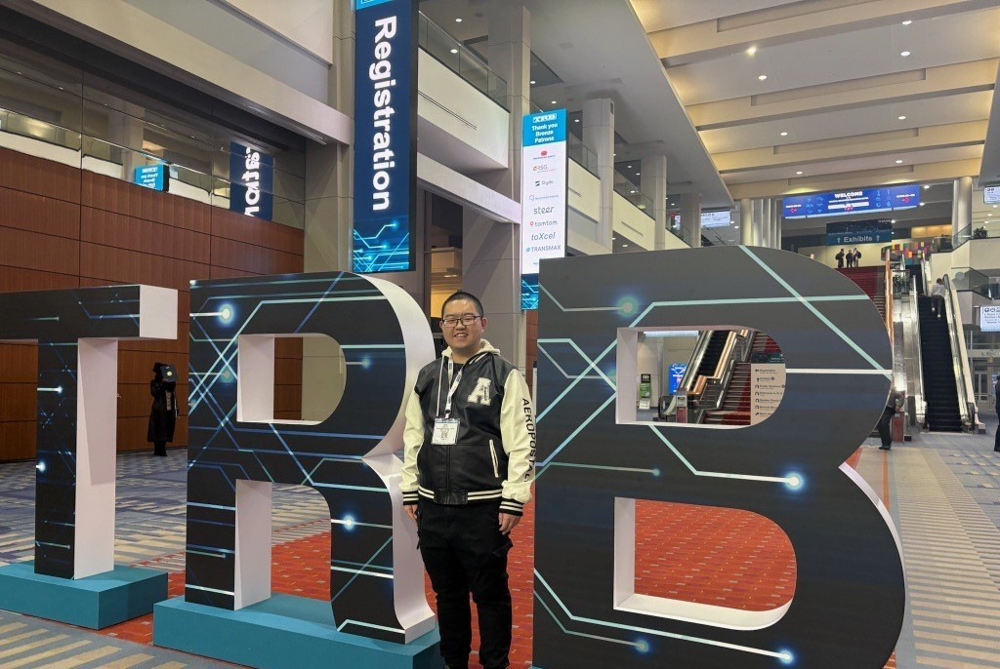
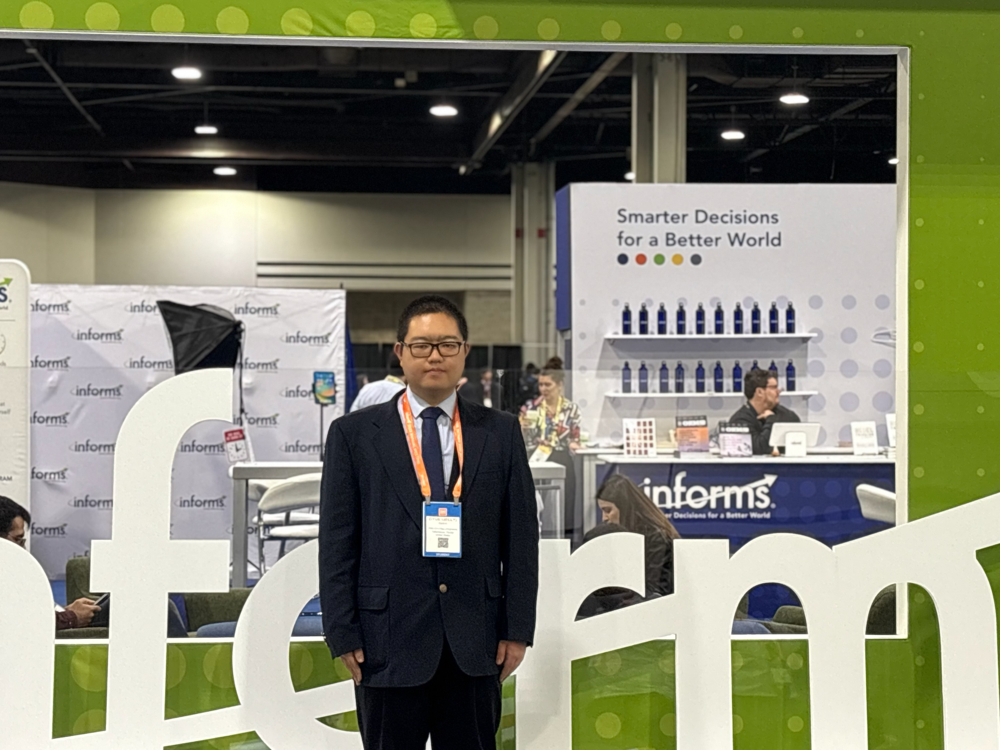

I am Ziyue (Jelly) Li, a Postdoctoral Researcher at Tilburg University (TiU) and a Postdoctoral Researcher (Courtesy) at Florida State University (FSU). My research applies stochastic modeling, economic analysis, and optimization methods to address challenges in urban transportation planning and decision-making. My work focuses on developing analytical and algorithmic approaches to support more efficient, intelligent, sustainable, and resilient transportation systems.

My current research interests are **Freight Mobility as a Service (FMaaS)** and **Transportation Infrastructure Investment under Uncertainty**. In FMaaS, I study how effective digital matching platforms can facilitate the efficient movement of goods through multimodal transportation by integrating services from multiple independent providers. I examine the consequences of such platforms, the conditions under which they are accepted and used, and their potential environmental and societal benefits. In transportation infrastructure investment, I study airport capacity management and expansion, as well as public transit planning and extension, accounting for uncertain demand and the economic behavior of decision makers, passengers, and operators.

I serve as the Principal Investigator of the NSF TUUI Collaborative Activity Group titled [*Resilient Underground Subway Infrastructure Maintenance Planning*](https://tuui.civil.gmu.edu/resilient_underground/
). This initiative aims to advance the understanding of underground subway infrastructure systems and improve maintenance planning strategies for these critical assets. **Key topics of interest include**:
- Infrastructure degradation modeling
- State-of-the-art infrastructure health monitoring technologies
- Vulnerability to natural disasters
- Data availability and integration
- Challenges in infrastructure maintenance planning
- Policies and practices used by transit agencies globally
- Impact of aging infrastructure and maintenance on service quality and ridership

Feel free to [reach out](mailto:zl23n@fsu.edu) if you are interested in this project or potential collaboration.

I regularly present at the [TRB Annual Meeting](https://trb-annual-meeting.nationalacademies.org/) and the [INFORMS Annual Meeting](https://meetings.informs.org/wordpress/seattle2024/). If you are attending, I would be glad to connect.

  
  

